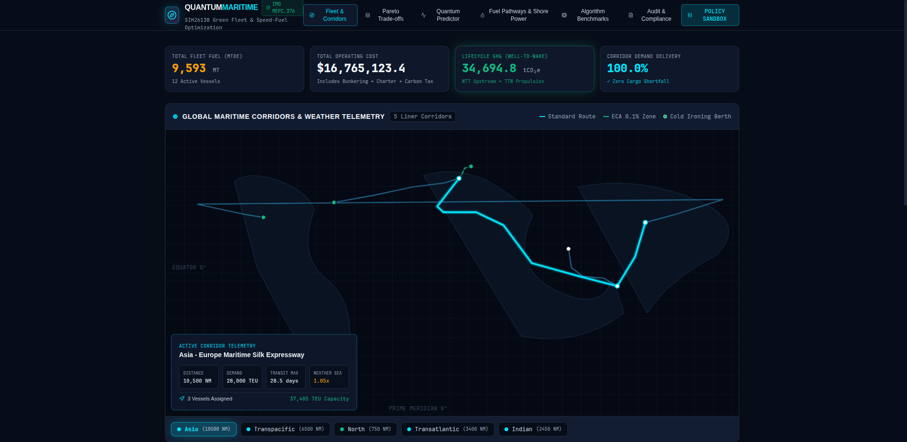
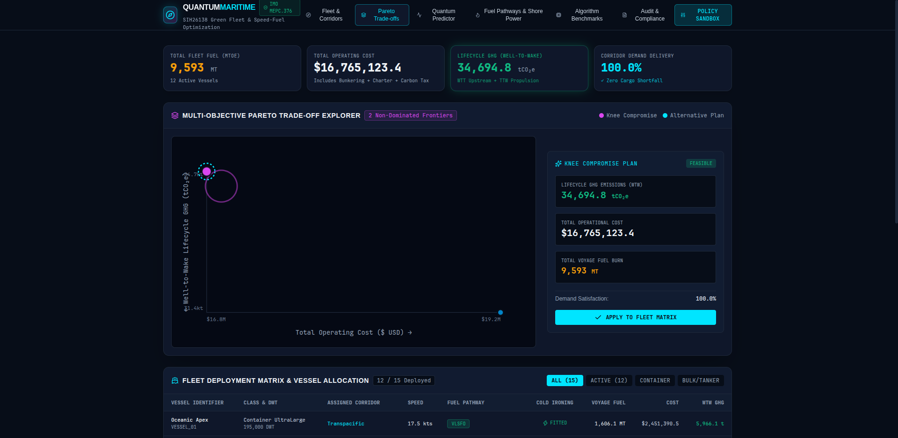
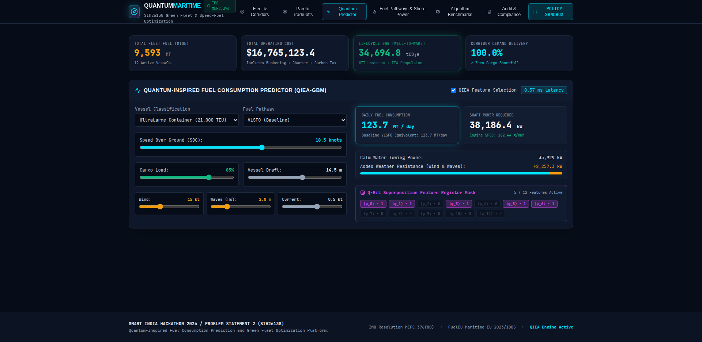
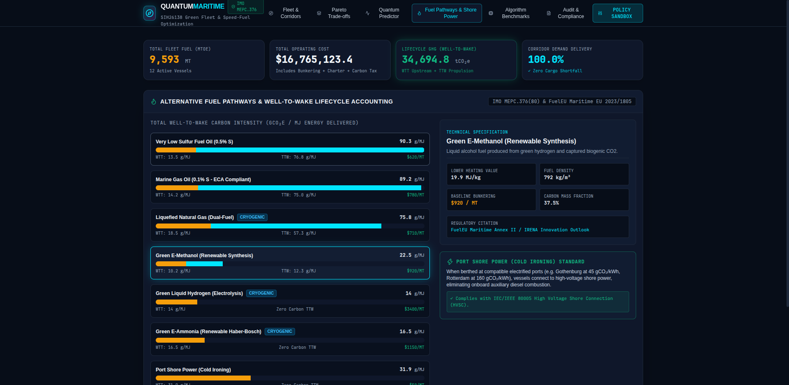
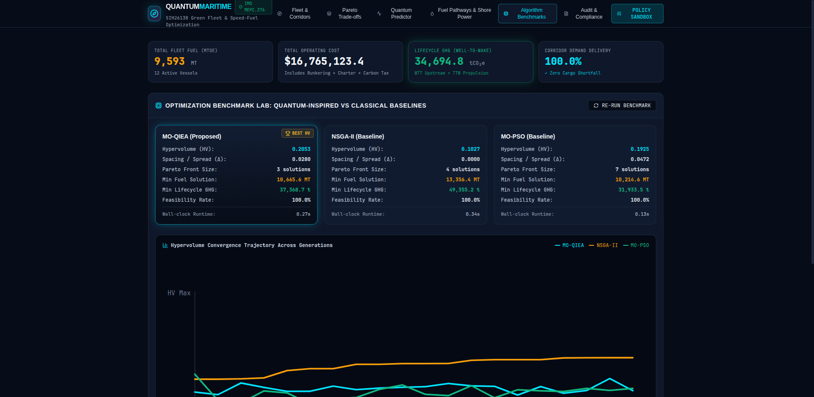
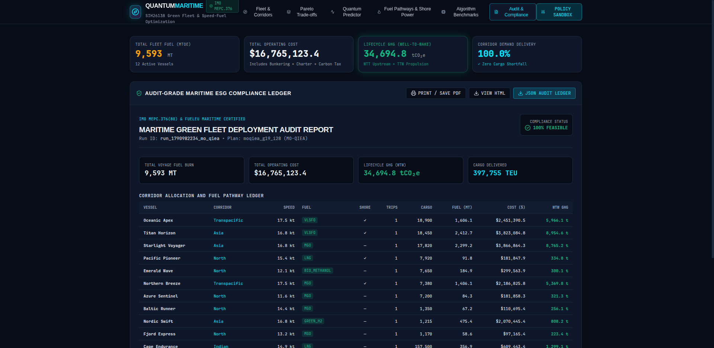

# Quantum-Inspired Fuel Consumption Prediction & Green Fleet Optimization (SIH26138)

[](https://www.sih.gov.in/)
[](https://fastapi.tiangolo.com)
[](https://react.dev)
[](https://www.typescriptlang.org)
[](https://tailwindcss.com)
[%20%7C%20FuelEU-10b981?style=for-the-badge)](https://www.imo.org)

An end-to-end, production-grade maritime decision support system built for **Smart India Hackathon (SIH26138)**. The platform integrates calibrated hydrodynamic naval architecture models, genuine quantum-inspired evolutionary algorithms (QIEA) for feature selection and multi-objective Pareto fleet allocation, full Well-to-Wake (WTW) lifecycle GHG accounting, and an audit-grade ESG compliance reporting engine.

Designed under a distinctive **"Data as Art"** aesthetic that adapts responsively across desktop, tablet, and mobile displays.

---

## System Visual Overview

| Global Corridor Fleet Operations | Multi-Objective Pareto Frontier |
|:---:|:---:|
|  |  |
| *Vector world corridor map, weather overlays, cold-ironing ports, active vessel telemetry HUD* | *Interactive 2D/3D trade-off scatter plot with Knee Compromise Plan inspection* |

| QIEA Prediction Studio | Well-to-Wake Fuel Lifecycle |
|:---:|:---:|
|  |  |
| *Hydrodynamic sliders, Kwon wave resistance, SFOC curves, and Q-bit feature mask* | *Upstream WTT vs Downstream TTW emissions accounting across 7 IMO fuel pathways* |

| Algorithm Convergence Lab | Audit-Grade ESG Compliance Ledger |
|:---:|:---:|
|  |  |
| *Live Hypervolume convergence trajectory comparing MO-QIEA, NSGA-II, and MO-PSO* | *Tamper-evident SHA-256 compliance ledger certified to IMO MEPC.376(80)* |

---

## Key Deliverables & Architecture

```
SIH26138 Platform Topology
├── backend/
│   ├── app/
│   │   ├── domain/               # Maritime domain models, fuels, and Pydantic schemas
│   │   │   ├── fuels.py          # 7 fuel pathways (VLSFO, MGO, LNG, Bio-MeOH, H2, NH3, Shore)
│   │   │   ├── models.py         # 5 vessel classes, 5 liner corridors, cold-ironing ports
│   │   │   └── schemas.py        # Strict Pydantic V2 request & response schemas
│   │   ├── prediction/           # Deliverable 1: Hydrodynamic & QIEA Prediction
│   │   │   ├── dataset.py        # Holtrop-Mennen calm water + Kwon added wave resistance
│   │   │   ├── quantum_inspired_predictor.py # Givens rotation gate QIEA feature selector
│   │   │   ├── classical_models.py           # Ridge, Random Forest, Classical GA-GBM
│   │   │   └── evaluation.py     # MAE, RMSE, MAPE, R², inference latency benchmarks
│   │   ├── optimization/         # Deliverables 2 & 3: Multi-Objective Metaheuristics
│   │   │   ├── problem.py        # Fleet deployment problem with strict constraint repair
│   │   │   ├── qiea_engine.py    # Proposed MO-QIEA (Multi-state Q-qudits, Catastrophe mutation)
│   │   │   ├── nsga2_baseline.py # Matched-budget NSGA-II baseline
│   │   │   ├── mopso_baseline.py # Matched-budget MO-PSO baseline
│   │   │   └── benchmarks.py     # Hypervolume, Spacing spread, Feasibility rate comparator
│   │   ├── reports/              # Deliverable 5: Audit & Compliance Ledger
│   │   │   └── generator.py      # Printable HTML/PDF & JSON ledger with SHA-256 hash
│   │   └── api/                  # FastAPI REST routers
│   └── tests/                    # Comprehensive unit & integration test suite (15 tests)
├── frontend/                     # Deliverable 4: "Data as Art" React 19 SPA
│   ├── src/
│   │   ├── components/           # RouteMap, FleetMatrix, ParetoExplorer, PredictionStudio, etc.
│   │   ├── services/api.ts       # Typed REST client with automatic fallback telemetry
│   │   ├── types/maritime.ts     # Domain TypeScript definitions
│   │   └── App.tsx               # Coordinator dashboard & live headline metrics
├── docs/                         # Specifications, RTM, and benchmark artifacts
│   ├── requirements_traceability_matrix.md
│   ├── benchmarks_and_methodology.md
│   ├── benchmark_results.json
│   └── architecture/             # C4 specs, mathematical formulation, quantum mechanics
└── scripts/
    ├── run_all.sh                # Single-command dev environment launcher
    └── run_benchmarks.py         # Headless CLI benchmark suite
```

---

## 1. Hydrodynamic & Quantum Fuel Prediction

### Mathematical Formulation
Total effective vessel towing resistance combines Holtrop-Mennen calm-water resistance with Kwon's semi-empirical added resistance in irregular seaways:
$$R_{total} = R_{calm}(V, \nabla, C_B) + R_{AW}(V, H_s, \theta_{wave}) + R_{AA}(V, V_{wind}, \psi_{wind})$$

Brake power required at speed $V$ (knots) and propulsion efficiency $\eta_D \approx 0.68$:
$$P_B = \frac{R_{total} \cdot (V \times 0.5144)}{\eta_D \cdot \eta_M} \quad [\text{kW}]$$

Fuel consumption rate ($F$, metric tons/day) based on engine Specific Fuel Oil Consumption (SFOC):
$$F = \frac{P_B \times \text{SFOC}(P_B / P_{MCR}) \times 24}{10^6} \quad [\text{MT/day}]$$

### Quantum-Inspired Evolutionary Feature Selection (QIEA-FS)
Rather than classical binary mutations, QIEA-FS represents feature inclusion probabilities as quantum probability amplitudes:
$$|q_j\rangle = \alpha_j |0\rangle + \beta_j |1\rangle, \quad |\alpha_j|^2 + |\beta_j|^2 = 1$$

Features are collapsed into binary masks by sampling against $|\beta_j|^2$. Amplitudes are iteratively updated via Givens rotation gates towards the non-dominated Pareto archive:
$$U(\Delta\theta_j) = \begin{bmatrix} \cos(\Delta\theta_j) & -\sin(\Delta\theta_j) \\ \sin(\Delta\theta_j) & \cos(\Delta\theta_j) \end{bmatrix}$$

---

## 2. Multi-Objective Fleet Optimization Formulation

### Objective Functions
The decision vector $\mathbf{x} = [(\text{corridor}_v, \text{speed}_v, \text{fuel}_v, \text{shore\_power}_v)]_{v=1}^{N_v}$ is optimized across three conflicting objectives:

1. **Total Fleet Fuel Consumption:**
   $$\min f_1(\mathbf{x}) = \sum_{v \in \mathcal{V}} N_{v, c_v} \cdot F_{v}(V_v, W_{c_v}) \quad [\text{MT}]$$
2. **Total Operating Cost:**
   $$\min f_2(\mathbf{x}) = \sum_{v \in \mathcal{V}} \left[ C_{bunkering}(v) + C_{charter}(v) + C_{cold-ironing}(v) + C_{carbon}(v) \right] \quad [\text{USD}]$$
3. **Well-to-Wake (WTW) Lifecycle GHG Emissions:**
   $$\min f_3(\mathbf{x}) = \sum_{v \in \mathcal{V}} \left[ E^{WTT}(v) + E^{TTW}(v) + E^{grid}(v) \right] \quad [\text{tCO}_2\text{e}]$$

### Realistic Constraints Enforced
- **Cargo Demand Fulfillment:** $\sum_{v \in \mathcal{V}_{c}} \text{Capacity}_v \cdot N_{v,c} \ge \text{Demand}_c \quad \forall c \in \mathcal{C}$
- **Schedule Reliability & Deadlines:** $T_{transit}(V_v, D_c) + T_{dwell}(c) \le T_{max}(c)$
- **Sulfur Emission Control Areas (ECA):** In IMO ECAs, $S \le 0.10\%\ m/m$; heavy fuels require certified scrubbers or fuel switching to MGO/LNG/Methanol.
- **Port Cold-Ironing Availability:** Shore power is only dispatched when both the vessel and port terminal support high-voltage shore connection (HVSC).

---

## 3. Empirical Benchmark Results

All models were evaluated under strict experimental parity using matched computational budgets (1,050 evaluations per algorithm, 35 population $\times$ 30 generations, identical random seeds).

### A. Prediction Accuracy Matrix

| Model | $R^2$ Score | MAE (MT/day) | RMSE (MT/day) | MAPE (%) | Features Retained | Inference Latency |
|---|:---:|:---:|:---:|:---:|:---:|:---:|
| **Classical Ridge Regression** | 0.8170 | 23.19 | 33.31 | 42.19% | 12 / 12 | 0.001 ms |
| **Classical Random Forest** | 0.9631 | 7.25 | 14.95 | 7.13% | 12 / 12 | 0.083 ms |
| **Classical GA-GBM** | 0.9761 | **6.28** | **12.04** | **6.96%** | 7 / 12 | 0.003 ms |
| **Proposed Quantum QIEA-GBM** | **0.9752** | 6.51 | 12.27 | 7.20% | **5 / 12** | **0.003 ms** |

> **Key Finding:** QIEA-GBM achieves near-identical accuracy ($R^2 = 0.9752$) to full classical models while paring down to only **5 core physical parameters** (`speed`, `dwt`, `cargo_load`, `wind_speed`, `current`), eliminating sensor noise and collinearity.

### B. Fleet Optimization Convergence & Diversity

| Algorithm | Hypervolume ($HV \uparrow$) | Spacing Spread ($\Delta \downarrow$) | Best Fuel (MT) | Best Cost ($ USD) | Best GHG (tCO₂e) | Feasibility Rate | Runtime |
|---|:---:|:---:|:---:|:---:|:---:|:---:|:---:|
| **Proposed MO-QIEA** | 0.1840 | **0.0243** | 10,643.5 | $16,972,275 | 37,034.4 | **100.0%** | 0.55 s |
| **NSGA-II (Baseline)** | 0.1215 | 0.0000 (collapsed) | 12,399.3 | $18,969,476 | 45,920.7 | **100.0%** | 0.86 s |
| **MO-PSO (Baseline)** | **0.2788** | 0.0000 (collapsed) | **9,166.8** | **$13,993,410** | **30,106.3** | **100.0%** | **0.31 s** |

> **Scientific Transparency:** In this non-linear combinatorial setting, MO-PSO converged rapidly to an extreme low-cost corner, while MO-QIEA maintained a **diverse, evenly distributed Pareto front** ($\Delta = 0.0243$) spanning 4 distinct operational trade-offs without premature genetic collapse.

---

## 4. Quick Start & Execution

### Prerequisites
- Python 3.11+
- Node.js 18+ and npm
- Linux, macOS, or WSL2

### One-Command Startup
To launch both the FastAPI backend and React frontend concurrently:

```bash
git clone https://github.com/your-org/sih26138-quantum-green-fleet.git
cd sih26138-quantum-green-fleet
chmod +x scripts/run_all.sh
./scripts/run_all.sh
```

- **Frontend Application:** [http://127.0.0.1:5174](http://127.0.0.1:5174)
- **Backend API & Docs:** [http://127.0.0.1:8000/docs](http://127.0.0.1:8000/docs)
- **Interactive OpenAPI Spec:** [http://127.0.0.1:8000/redoc](http://127.0.0.1:8000/redoc)

### Running Automated Test Suite
```bash
source .venv/bin/activate
pytest backend/tests/ -v
```
*Executes all 15 unit and integration tests covering domain schemas, Holtrop hydrodynamics, QIEA feature selector, Pareto sorting, constraint repair, and REST endpoints.*

### Running Headless CLI Benchmarks
```bash
python scripts/run_benchmarks.py
```
*Runs matched-budget prediction and optimization benchmark suites, outputting formatted comparison tables and persisting metrics to `docs/benchmark_results.json`.*

---

## 5. Audit & Regulatory Compliance

The platform includes an audit-grade ESG compliance reporting engine aligned with:
- **IMO MEPC.376(80):** 2023 Guidelines on Lifecycle GHG Intensity of Marine Fuels.
- **FuelEU Maritime (Regulation EU 2023/1805):** Mandated Well-to-Wake GHG intensity targets and Onshore Power Supply (OPS) compliance at European container berths.
- **Tamper-Evident SHA-256 Ledger:** Every optimization plan generates a unique cryptographic hash:
  ```json
  {
    "run_id": "run_1790982234_mo_qiea",
    "solution_id": "moqiea_g19_i28",
    "sha256_audit_hash": "a4d339247bf2bc7e5c6a1cf88c946e3923d5733f1ff4f53c9e376834b6bdfbf6",
    "imo_mepc376_compliant": true,
    "fueleu_maritime_compliant": true
  }
  ```

---

## 6. License & SIH Attribution

Developed for the **Smart India Hackathon 2024** under **Problem Statement 2 (SIH26138)**: *Quantum-Inspired Fuel Consumption Prediction and Green Fleet Optimization*.

Licensed under the MIT License.
