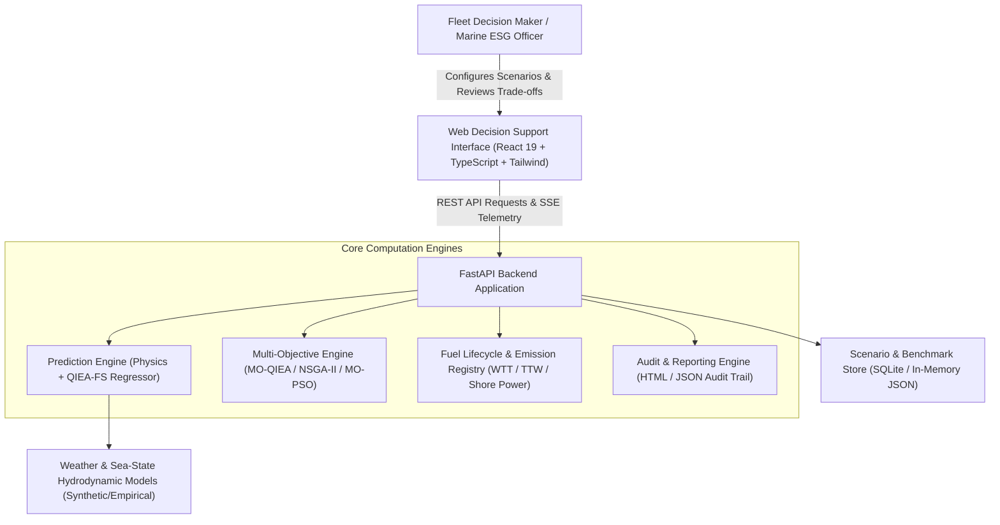

# System Context and Component Architecture
## Project: Quantum-Inspired Fuel Consumption Prediction and Green Fleet Optimization

### 1. System Context (C4 Level 1)
The platform is an autonomous maritime decision-support system operating between commercial vessel operations, maritime environmental compliance registries, and weather intelligence services.

---

### 2. Component Architecture (C4 Level 2)

```mermaid
graph LR
    subgraph Frontend [Frontend Layer - Adaptive Art Direction]
        MapComp[Route & Weather Canvas Map]
        MatrixComp[Fleet Allocation Matrix]
        ParetoComp[Pareto 3D/2D Front Explorer]
        FuelComp[Fuel Pathway & Shore Power View]
        BenchComp[Quantum Benchmark Lab]
        SandboxComp[Scenario Simulation Controls]
    end

    subgraph API [FastAPI Backend Endpoints]
        P_API["/api/predict/*"]
        O_API["/api/optimize/*"]
        B_API["/api/benchmarks/*"]
        S_API["/api/scenarios/*"]
        R_API["/api/reports/*"]
    end

    subgraph ServiceLayer [Domain & Computational Logic]
        Hydro["Vessel Hydrodynamic Engine (Holtrop-Mennen & Cubic Speed-Power)"]
        QFS["QIEA Feature Selector (Superposition Q-bits & Rotation)"]
        PredGBM["Gradient Boosted Fuel Regressor"]
        FleetProb["FleetDeploymentProblem (Demand, Schedule, Tank Capacity, ECA limits)"]
        QIEA["MO-QIEA Solver (Multi-state Q-bit Register & Catastrophe Gate)"]
        Baselines["Classical Solvers (NSGA-II, MO-PSO)"]
    end

    Frontend --> API
    API --> ServiceLayer
```

---

### 3. Subsystem Breakdown and Boundaries

1. **Prediction Engine (`backend.app.prediction`)**:
   - Ingestion: Speed over ground, displacement, cargo load, draft, wind force (Beaufort), wave height ($H_s$), sea current, hull biofouling factor.
   - Quantum-Inspired Feature Selection (QIEA-FS): Applies Q-bit register where probability amplitudes determine feature presence in regression subsets.
   - Regression Estimator: Gradient Boosted Regressor trained on 10,000+ physics-grounded synthetic operational voyages.
   - Baselines: Ridge Regression, Standard Random Forest, and Classical GA-Feature Selection for benchmarking.

2. **Optimization Engine (`backend.app.optimization`)**:
   - Formulation: 3 continuous/discrete objectives: $f_1(\mathbf{x})$ Total Fuel (MT), $f_2(\mathbf{x})$ Total Cost (\$ USD), $f_3(\mathbf{x})$ Lifecycle GHG emissions ($t	ext{CO}_2	ext{e}$ WTW).
   - Quantum-Inspired Metaheuristic: Multi-Objective Quantum-Inspired Evolutionary Algorithm (MO-QIEA) with multi-state Q-bit representation, dynamic quantum rotation lookup table, and quantum catastrophe mutation.
   - Conventional Baselines: Non-dominated Sorting Genetic Algorithm II (NSGA-II) and Multi-Objective Particle Swarm Optimization (MO-PSO) matching identical function evaluation budgets.

3. **Domain & Fuel Lifecycle Registry (`backend.app.domain`)**:
   - Strict separation of Well-to-Tank (WTT) upstream extraction/synthesis emissions and Tank-to-Wake (TTW) combustion emissions.
   - Shore Power (Cold Ironing) modeled as port-berth auxiliary load substitution based on grid carbon intensity.
   - Validates vessel engine compatibility and tank insulation constraints (cryogenic LNG, liquid hydrogen, toxic ammonia, ambient liquid methanol).

4. **Web Decision Support Interface (`frontend`)**:
   - "Data as Art" visual composition: dark maritime oceanic styling (`#070d18`), luminescent cyan/seafoam/amber telemetry vectors.
   - Adaptive art direction across desktop (12-column asymmetric spatial view), tablet (balanced editorial), and mobile (intimate touch-first vertical layout).
   - Interactive components: Global Route Map, Fleet Allocation Matrix, 3D/2D Pareto Front Explorer, Fuel Pathway Lifecycle Breakdown, Quantum vs Classical Benchmark Lab, Policy Sandbox, and printable Audit Report.
